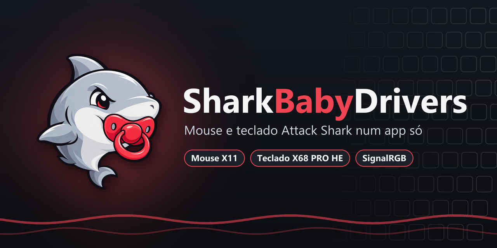

<p align="center">
  
</p>

<p align="center">
  <a href="https://github.com/Juancjc/SharkBabyDrivers/releases/latest"></a>
  <a href="https://github.com/Juancjc/SharkBabyDrivers/actions/workflows/ci.yml"></a>
  
  
</p>

# SharkBabyDrivers

Um app só, leve e em português (ou inglês), para configurar o **mouse Attack Shark X11** e o
**teclado Attack Shark X68 PRO HE** — substitui os dois programas oficiais.

- Barra lateral com cada periférico conectado (detecta ligar/desligar na hora).
- **Backup antes de tudo:** ao conectar, o app lê o que está salvo *dentro* do dispositivo e guarda um
  único backup **ORIGINAL** por dispositivo, sem substituí-lo nas conexões seguintes. Nada é aplicado antes disso.
  Pelo receptor 2.4G e no X68 V2 (id 2901) também pelo cabo, o backup do teclado inclui Hall Effect somente
  do perfil ativo. A leitura desse modelo usa apenas consultas, sem trocar o perfil.
- Na aba **Salvos e backup**, salve configurações com nome, carregue, importe e exporte perfis, ou restaure e
  exporte o backup original. Os perfis salvos ficam agrupados por modelo e podem ser usados pelo cabo ou receptor.
- Grava só o que mudou, ao clicar em **Aplicar no dispositivo** (com *Descartar alterações*).

## O que dá para configurar

**Mouse X11** (cabo ou receptor 2.4G)
- 8 estágios de DPI (50–22 000) com cor de cada um e estágio em uso
- Taxa de polling 125/250/500/1000 Hz, angle snap, ripple control, debounce (4–50 ms)
- Função dos 6 botões: cliques, DPI, mídia, navegador, atalhos prontos, atalho personalizado, macro
- Iluminação (7 efeitos, cor, brilho, velocidade), sono e sono profundo
- Macros gravadas pelo teclado, com repetição; bateria em tempo real; reset de fábrica

**Teclado X68 PRO HE** (cabo USB ou receptor 2.4G, com as limitações abaixo)
- 4 perfis da memória do teclado; camadas Normal, Fn Windows e Fn Mac
- Remapeamento de qualquer tecla: tecla/combinação, mouse, mídia, energia, macro, troca de perfil
- Hall Effect por tecla ou em grupo: acionamento, soltura, Rapid Trigger (sensibilidades), zonas mortas
  superior/inferior, tipo de switch, DKS, Mod-Tap, Toggle, Snap Tap/SOCD, calibração
- Iluminação (19 efeitos com variações, cor/arco-íris, brilho, velocidade)
- Polling até 8000 Hz, debounce, detecção de SO, anti-toque acidental, estabilidade do RT, troca WASD↔setas,
  timers de sono; macros. O reset de fábrica do teclado fica desativado por segurança, inclusive pelo cabo.

> **Teclado pelo receptor 2.4G (`3151:5026`):** permite ler e aplicar configurações, incluindo iluminação e
> Hall Effect do **perfil ativo**. A troca de perfil e a calibração ficam desativadas sem fio. No **X68 V2
> (id 2901), a ativação de perfil pelo app também fica bloqueada pelo cabo**: durante uma leitura automática,
> houve perda da digitação e dos LEDs perto de uma troca de perfil. Esse é o principal indício nos registros,
> sem confirmar sozinho a causa. Para configurar HE de outro perfil, troque-o no próprio teclado e faça uma
> nova leitura no app. As matrizes de teclas dos quatro perfis podem ser lidas sem trocar o perfil ativo.
> Após aplicar pelo receptor, o app relê os dados e tenta novamente o que não
> foi confirmado. Antes de gravar, também confere o perfil ativo no teclado e interrompe a aplicação se ele
> mudou desde a leitura. A leitura é mais lenta que pelo cabo.
>
> Aperte uma tecla antes de conectar para acordar o teclado; enquanto ele dorme, o app tenta novamente a cada
> 3 segundos.

## SignalRGB e ícone na bandeja

Escolha **quem controla a iluminação do teclado** na aba *Iluminação* do X68 ou no ícone da bandeja:

- **SignalRGB:** o teclado entra no modo "cor da tela" e passa a seguir o SignalRGB (as fans e o resto continuam
  no SignalRGB normalmente). As cores chegam pelo plugin do SharkBabyDrivers e é o próprio SharkBabyDrivers quem
  as envia ao teclado, entre as suas leituras e gravações. Durante um backup, *Aplicar* ou carregar perfil, as
  cores pausam por alguns segundos e voltam sozinhas. Enquanto o SignalRGB estiver no controle, o app não grava
  iluminação (nem ao aplicar, carregar perfis ou restaurar backups).
- **SharkBabyDrivers:** as cores do SignalRGB são ignoradas — nada do SignalRGB chega ao teclado — e o teclado
  volta à iluminação que tinha antes.

Na primeira vez, o app oferece instalar o plugin em `Documentos\WhirlwindFX\Plugins` (ele substitui o plugin
padrão do X68 no SignalRGB); depois **reinicie o SignalRGB** e deixe o teclado ativado nele. Vale para o cabo e
o receptor: com o cabo conectado o app usa só o cabo; ao desconectar, volta para o receptor.

**Apagar a luz para poupar bateria (receptor):** o ajuste *Apagar luz após (sem fio)* (aba Desempenho) vale nos
dois modos. Com o SharkBabyDrivers no controle, o próprio teclado apaga; com o SignalRGB, o app manda preto depois
desse tempo sem tecla **neste** teclado e para de enviar (o rádio fica quieto); a primeira tecla traz as cores de
volta. O app só percebe *quando* uma tecla do X68 é apertada (Raw Input do Windows), nunca *qual*. `0` = nunca.

**Uma cor por vez:** com o SignalRGB, o teclado inteiro mostra uma cor só. O firmware original só aceita cor ao vivo
para o teclado todo (`0x0E`); cor por tecla existe apenas como "imagem de LED" gravada na memória — mandar isso a
cada quadro traria de volta as piscadas e o desgaste. Efeitos de duas cores (onda sobre um fundo) aparecem como a
cor do ponto em que o teclado está no layout do SignalRGB, trocando conforme a onda passa.

**Por que piscava:** o plugin padrão do SignalRGB envia o comando de iluminação `0x07` (modo, brilho e cor) a cada
quadro. O teclado grava esse comando na memória e reinicia o efeito a cada vez — ~30 gravações por segundo. O
plugin novo usa o comando de "cor da tela" `0x0E`, que não é gravado na memória e não reinicia nada.
Detalhes e medições em [`docs/SIGNALRGB.md`](docs/SIGNALRGB.md).

**Bandeja:** fechar a janela deixa o app no ícone da bandeja (perto do relógio), que mostra quem controla a
iluminação, a conexão (cabo/receptor) e se as cores do SignalRGB estão chegando; o ponto no ícone fica com a
cor atual. Pelo menu: alternar o controle, **Iniciar com o Windows** (abre só na bandeja, ~25 MB e quase nada de
CPU, sem ler o teclado inteiro até você abrir a janela), abrir ou sair.

> **Teclas vermelhas filtram a cor:** azul e verde aparecem fracos ou escurecidos sob keycaps vermelhas. Para
> conferir a cor real, olhe um switch sem tecla.

## Baixar

Pegue a última versão em **[Releases](https://github.com/Juancjc/SharkBabyDrivers/releases/latest)**:
- `…-win-x64.zip` — leve, precisa do [.NET 8 Desktop Runtime](https://dotnet.microsoft.com/download/dotnet/8.0)
- `…-win-x64-portable.zip` — não precisa instalar nada

## Versões

A versão fica em `Directory.Build.props` e segue [SemVer](https://semver.org/lang/pt-BR/) a partir dos commits
(`fix` → patch, `feat` → minor, `!`/`BREAKING CHANGE` → major). Para publicar:

```powershell
git tag v1.1.0
git push origin v1.1.0   # o workflow Release testa, compila e cria a release com os .zip
```

## Rodar a partir do código

Requer Windows 10/11 e o [.NET 8 SDK](https://dotnet.microsoft.com/download/dotnet/8.0).

Para testar **sem instalar**, dê dois cliques em `Testar.cmd` na pasta do projeto. Ele compila a versão
atual e abre o app diretamente dessa pasta. Feche a janela do app antes de recompilar. Apenas uma cópia
do SharkBabyDrivers pode ficar aberta por vez, para evitar disputa pelo dispositivo.

```powershell
dotnet run --project src/SharkBabyDrivers            # app
dotnet run --project src/SharkBabyDrivers -- --demo  # + um X68 simulado para conhecer as telas
dotnet run --project src/SharkBabyDrivers -- --preview # prévia isolada, somente simulador, sem acessar HID/SignalRGB
dotnet test                                          # testes de protocolo e do simulador do teclado
```

Instalar ou atualizar no próprio PC (por usuário, sem administrador), a partir do código:

```powershell
powershell -ExecutionPolicy Bypass -File tools\Install-Local.ps1   # publica, encerra a cópia aberta, instala e abre
```

Instala em `%LOCALAPPDATA%\Programs\SharkBabyDrivers` com atalho no Menu Iniciar e desinstalador em
*Aplicativos instalados*. Não mexe nos dados (`%LOCALAPPDATA%\SharkBabyDrivers`), no SignalRGB nem na escolha de
*Iniciar com o Windows* (só atualiza o caminho se já estiver ligado).

Gerar um executável leve (depende do runtime, ~500 KB):

```powershell
dotnet publish src/SharkBabyDrivers -c Release -r win-x64 --self-contained false -p:PublishSingleFile=true -o publish
```

Não precisa de administrador nem de driver: tudo é feito por HID padrão do Windows.
Evite configurar o mesmo dispositivo simultaneamente em outro programa. Se houver disputa, pause apenas
o controle desse dispositivo no outro app durante a configuração.

## Onde ficam os dados

`%LOCALAPPDATA%\SharkBabyDrivers\`
- `backups\<dispositivo>\original.json` — único backup original por dispositivo
- `saved-profiles\<modelo>\*.sbd.json` — configurações salvas com nome na aba *Salvos e backup*
- `profiles\` — botões e macros do X11 (o mouse não deixa ler isso de volta)
- `settings.json` (idioma, quem controla a iluminação), `sharkbabydrivers.log`
- `lighting.log` — uma linha por mudança de estado da ponte com o SignalRGB (útil para pedir ajuda)

## Estrutura

| Pasta | Conteúdo |
|---|---|
| `src/SharkBabyDrivers.Core` | HID (P/Invoke, sem dependências), protocolos X11 e X68, backups, perfis |
| `src/SharkBabyDrivers` | App WPF (.NET 8): tema escuro vermelho, PT-BR/EN |
| `integrations/signalrgb` | Plugin do SignalRGB (embutido no app e instalado por ele) |
| `tools/Install-Local.ps1` | Instalador local por usuário (publica, instala, atalhos e desinstalador) |
| `tools/SharkBabyDrivers.Cli` | Diagnóstico: `list`, `dump`, `backup` (somente leitura) |
| `tests/SharkBabyDrivers.Tests` | xUnit: checksums, codecs, capturas reais do X11, ciclos completos no simulador do X68 |
| `docs/` | Protocolos documentados (engenharia reversa dos apps oficiais) |

## Aviso

Projeto independente, sem relação com a Attack Shark. Os protocolos foram obtidos por engenharia reversa
dos programas oficiais para interoperabilidade. Use por sua conta; os backups existem justamente para
poder voltar atrás.
